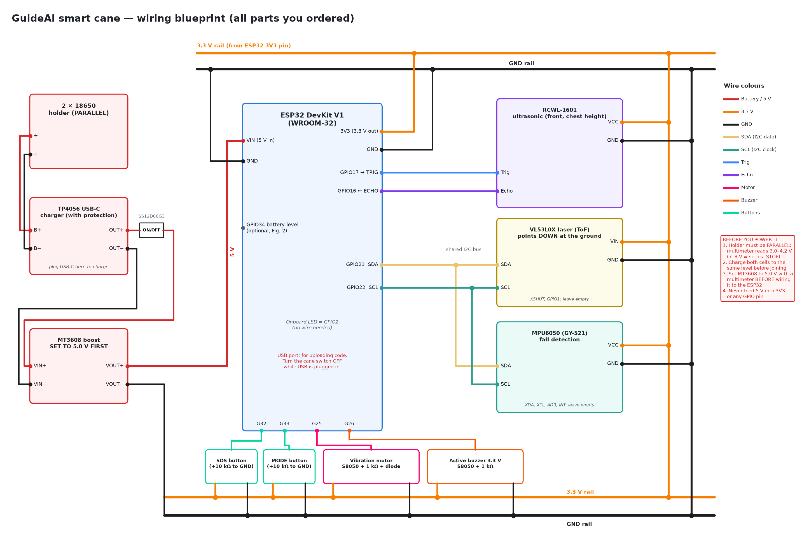
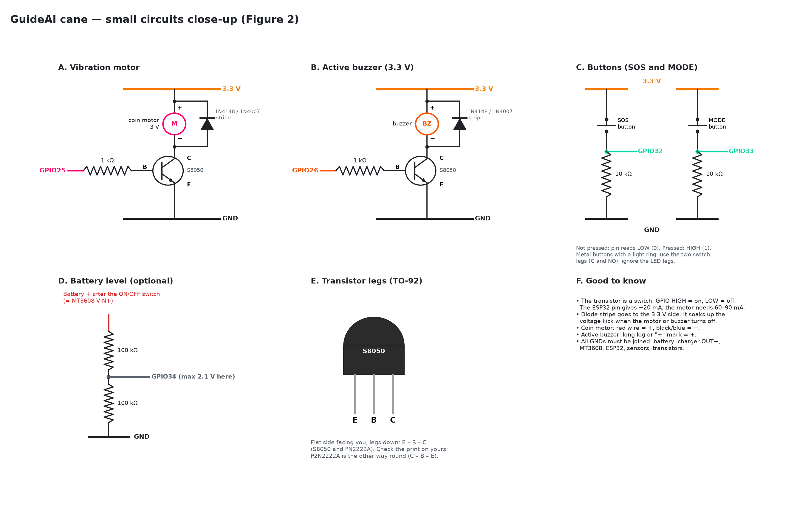

# GuideAI Smart Cane — Wiring Blueprint

How to connect every part you ordered ([PARTS.md](PARTS.md)). Build it on the **breadboard first**,
test one part at a time, and only solder onto the perfboard once everything works.

The images are generated by `make_wiring_diagram.py` (run it again if you change a pin).

---

## 1. Safety checks BEFORE you connect power

| # | Check | How | If wrong |
|---|---|---|---|
| 1 | **Battery holder is wired in PARALLEL** | Put both batteries in; multimeter on DC volts across the holder's red and black wires | **3.0–4.2 V = OK.** About 7–8 V = it's wired in *series*: do **not** connect it to the TP4056. Use one cell, or rewire the holder for parallel. |
| 2 | **Both 18650 cells at the same charge** | Measure each cell alone | If they differ by more than 0.1 V, charge them separately first. Joining a full and an empty cell makes a big current flow between them. |
| 3 | **TP4056 is the "with protection" version** | It has **6 pads**: `B+ B− OUT+ OUT−` plus the USB-C port | If it only has `B+ B−` (4 pads), it charges but doesn't protect: connect the battery **and** the load to `B+ B−`, and never let the battery run flat. |
| 4 | **MT3608 set to 5.0 V** | Connect only the battery to its `VIN+ VIN−`, measure `VOUT+ VOUT−`, turn the tiny brass screw until it reads **5.0 V** (counter-clockwise usually lowers it) | Never connect it to the ESP32 before this. Out of the box it can output 12 V or more, which destroys the ESP32. |
| 5 | **Switch OFF while USB is plugged into the ESP32** | — | Powering the ESP32 from USB and the battery at the same time can push current back into the computer's USB port. |

## 2. Pin map

| From | To (ESP32 pin) | Wire colour in the diagram |
|---|---|---|
| **Power chain** | | |
| Battery holder `+` | TP4056 `B+` | red |
| Battery holder `−` | TP4056 `B−` | black |
| TP4056 `OUT+` | Slide switch (middle leg), other leg → MT3608 `VIN+` | red |
| TP4056 `OUT−` | MT3608 `VIN−` | black |
| MT3608 `VOUT+` (5.0 V) | **ESP32 `VIN`** | red |
| MT3608 `VOUT−` | GND rail (and ESP32 `GND`) | black |
| ESP32 `3V3` | **3.3 V rail** (powers everything below) | orange |
| ESP32 `GND` | **GND rail** | black |
| **RCWL-1601 ultrasonic** (front, chest height) | | |
| `VCC` | 3.3 V rail | orange |
| `GND` | GND rail | black |
| `Trig` | **GPIO17** | blue |
| `Echo` | **GPIO16** (no resistor divider needed at 3.3 V) | purple |
| **VL53L0X laser** (points down at the ground ahead) | | |
| `VIN` | 3.3 V rail | orange |
| `GND` | GND rail | black |
| `SDA` | **GPIO21** | yellow |
| `SCL` | **GPIO22** | teal |
| `XSHUT`, `GPIO1` | leave unconnected | — |
| **MPU6050 GY-521** (fall detection) | | |
| `VCC` | 3.3 V rail | orange |
| `GND` | GND rail | black |
| `SDA` | **GPIO21** (shared with the VL53L0X) | yellow |
| `SCL` | **GPIO22** (shared with the VL53L0X) | teal |
| `XDA`, `XCL`, `AD0`, `INT` | leave unconnected | — |
| **Vibration motor** (Figure 2A) | | |
| GPIO25 → 1 kΩ → S8050 **B** | **GPIO25** | pink |
| S8050 **E** → GND, **C** → motor `−` | | |
| Motor `+` (red wire) → 3.3 V | | |
| Diode across the motor, **stripe to 3.3 V** | | |
| **Active buzzer 3.3 V** (Figure 2B) | | |
| Same as the motor, with a second S8050 | **GPIO26** | dark orange |
| **SOS button** (Figure 2C) | | |
| One leg → 3.3 V, other leg → GPIO32 **and** 10 kΩ → GND | **GPIO32** | green |
| **MODE button** (Figure 2C) | | |
| One leg → 3.3 V, other leg → GPIO33 **and** 10 kΩ → GND | **GPIO33** | green |
| **Battery level, optional** (Figure 2D) | | |
| Switch output (MT3608 `VIN+`) → 100 kΩ → GPIO34 → 100 kΩ → GND | **GPIO34** | grey |

The two I2C sensors share `SDA`/`SCL` without trouble because they have different addresses
(VL53L0X `0x29`, MPU6050 `0x68`). Both boards already have their own pull-up resistors.

**Pins avoided on purpose:** GPIO0, 2, 12 and 15 affect how the ESP32 starts up, and GPIO6–11 are
used by its flash memory. GPIO34 can only read (input), which is fine for the battery level.

## 3. Why the MT3608 is used

The ESP32 board's own regulator needs about **5 V on `VIN`** to make a steady 3.3 V. One 18650
gives 3.0–4.2 V, which is too low and makes the ESP32 reset at random, especially when Bluetooth
transmits. The MT3608 raises the battery to 5.0 V for `VIN`; everything else runs from the ESP32's
3.3 V pin. (This is why [PARTS.md](PARTS.md) originally said "no MT3608": that was before the power
wiring was planned.)

## 4. Build order (one part at a time)

Test each step before adding the next. Upload code over USB with the **cane switch OFF**.

1. **ESP32 alone on USB.** Upload a "blink" program (onboard LED = GPIO2). Proves the board and the
   USB cable work.
2. **Ultrasonic (RCWL-1601).** Wire it, read the distance in the Serial Monitor, move your hand
   in front of it.
3. **VL53L0X.** Wire SDA/SCL, run an I2C scanner: it should find `0x29`. Read the distance to the floor.
4. **MPU6050.** Add it to the same SDA/SCL. The I2C scanner should now find `0x29` **and** `0x68`.
5. **Vibration motor circuit.** Transistor + 1 kΩ + diode. Turn GPIO25 on/off: the motor buzzes.
6. **Buzzer circuit.** Same on GPIO26.
7. **Buttons.** Print the GPIO32 and GPIO33 values while pressing them.
8. **Battery power.** Do the safety checks in section 1, then connect the power chain and run
   everything from the battery with USB unplugged.
9. **Perfboard and box.** Move the circuit to the perfboard (ESP32 on female headers, sensors on
   4-pin header sockets or wires), fit it in the 158 × 90 mm box, and mount it on the cane.

**Where the sensors go on the cane:** the ultrasonic faces **forward** at chest height; the VL53L0X
points **down and forward** at the ground about one step ahead of the cane tip; the MPU6050 sits
flat inside the box; the motor goes against the inside of the handle where the hand rests; the
buttons go on the handle where the thumb reaches.

## 5. Next step

The ESP32 program (sensor readings, on-cane warnings with the motor and buzzer, and the Bluetooth
link to the app described in [PROTOCOL.md](PROTOCOL.md)) uses exactly these pins.
